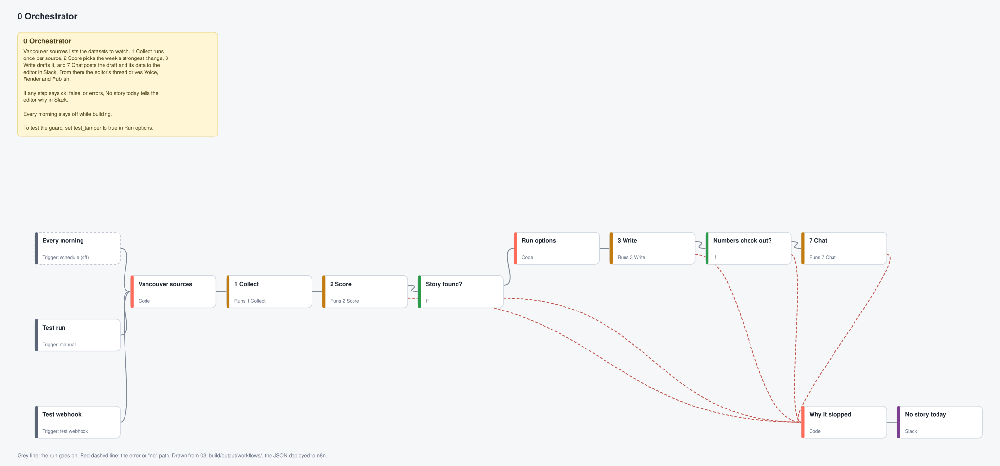
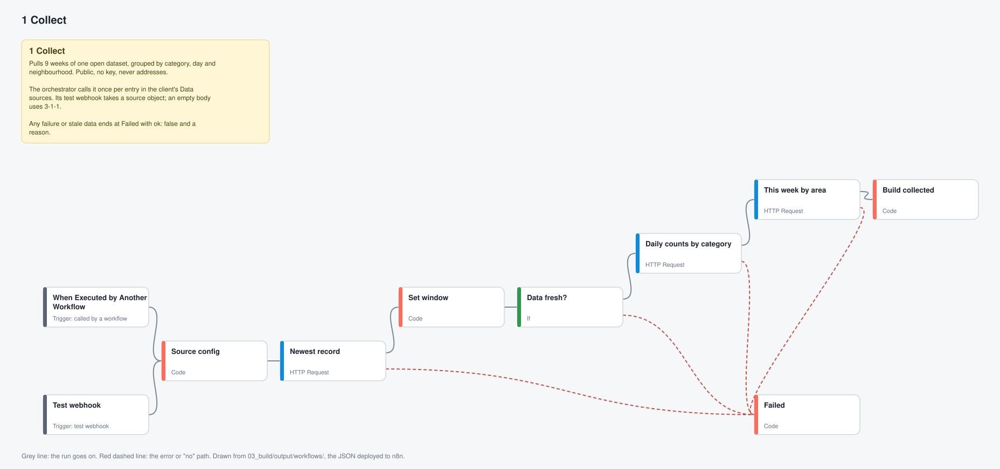
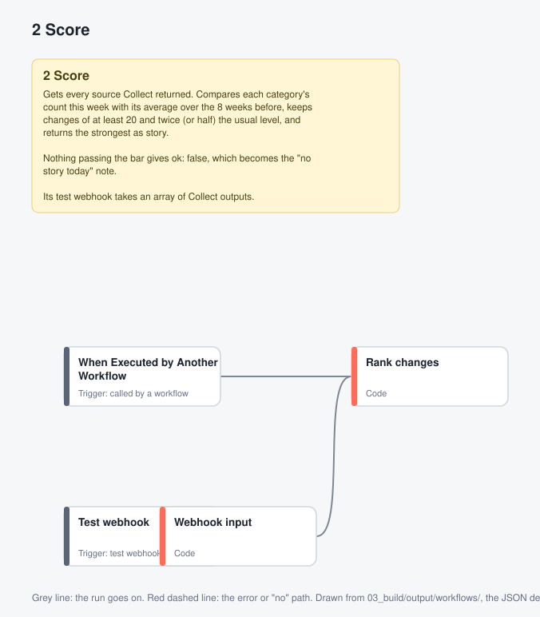
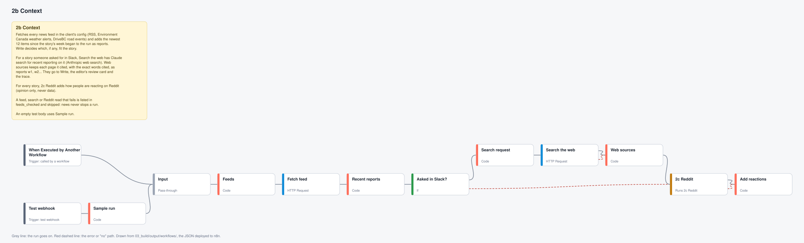
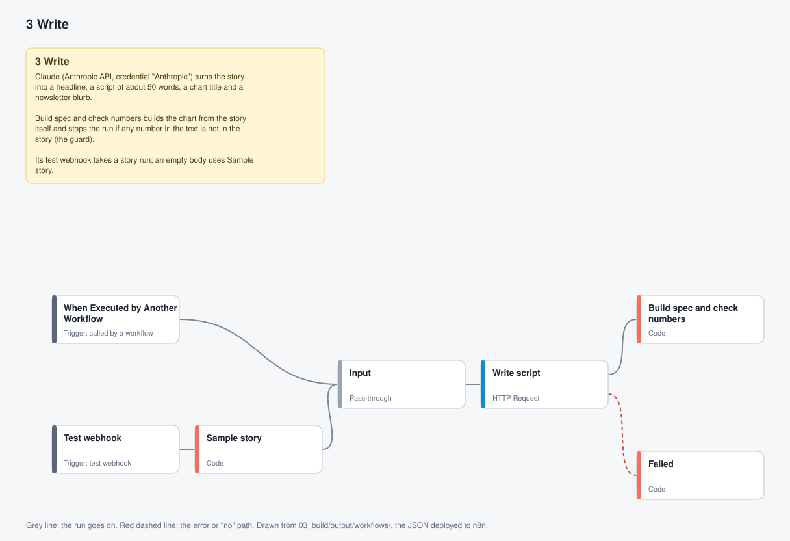
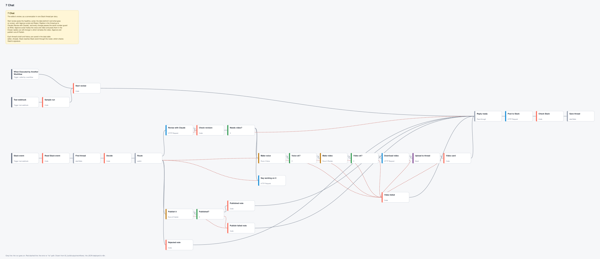
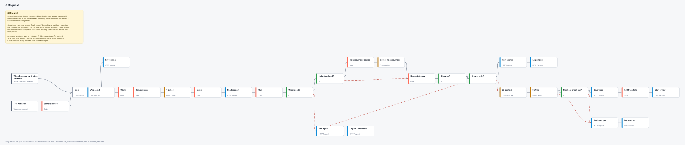

# newsReels pipeline

The source for all ten n8n workflows, written by Arman and Vinayak with Claude Code and running end to end since the evening of 14 November. Each run serves one client (D13, D15), set in one file in [../clients/](../clients/): its name and look, Slack channels, data sources, news feeds and style card. The build puts that file into a "Client" node.

- `code/`: every Code node and the prompts
- [build.mjs](build.mjs): writes the workflow JSON and a picture of each canvas into [../workflows/](../workflows/) (`npm run pipeline`)
- [test.mjs](test.mjs): runs the workflows' own Code nodes against live data (`npm run test:pipeline`)

| Workflow | Does |
| --- | --- |
| 0 Orchestrator | Loads the client, runs Collect for each data source, then Score, Context and Write, saves the trace, and hands the draft to 7 Chat; sends "No story today" when a step stops |
| 1 Collect | 9 weeks of one dataset, grouped by category, day and neighbourhood |
| 2 Score | Picks the week's strongest change across all sources |
| 2b Context | Reads the client's news feeds and adds the newest reports since the story's week began |
| 3 Write | Claude Sonnet 5.5 writes the headline, script, chart title and blurb in the client's style, with at most one sentence from a report it names; the guard checks every number and records where it came from |
| 4 Voice | ElevenLabs reads the script, stops if it runs 22 seconds or longer, and records the credits used |
| 5 Render | The Remotion service beside n8n makes the 9:16 video |
| 6 Publish | Saves the final trace, then posts the video, blurb and public "How this story was made" link to the outlet channel |
| 7 Chat | The editor's review in one Slack thread per story: script and data first, then the video. Replies change either one through Claude Haiku 5.5, and the guard checks every change (D14) |
| 8 Request | Someone mentions @Newsroom in the editor channel; Claude Haiku matches the ask to real categories and a neighbourhood, code builds the story or a quick answer, and a video request opens a review in the same thread (D17) |

Every run also has a trace and a row in the run ledger, saved by the render service: see its [README](../render-service/README.md).

## See the workflows

A member account on our self-hosted n8n sees only the workflows it made (sharing is a paid n8n feature), so `npm run pipeline` draws each canvas from the same JSON it deploys. They are redrawn on every build.

## Getting it into n8n

1. Change code in `code/`, `build.mjs` or the client file, never the JSON in `workflows/`. Then `npm run pipeline` and `npm run test:pipeline`.
2. `npm run deploy` pushes all ten, the orchestrator last, creates the data table `editor_threads` that 7 Chat keeps its threads in, and points every Execute Workflow node at its workflow by name. Workflows that call each other are linked on a second pass.
3. These credentials must exist in n8n with exactly these names. Put their values in the git-ignored `.env` (`ANTHROPIC_API_KEY`, `ELEVENLABS_API_KEY`, `RENDER_TOKEN`, `SLACK_BOT_TOKEN`) and run `npm run credentials`, which creates or updates each one and skips blanks. Then deploy again.

| Name | Type | Used by |
| --- | --- | --- |
| Anthropic | Anthropic | 3 Write, 7 Chat, 8 Request |
| ElevenLabs | Header Auth, header `xi-api-key`; the key needs User: Read for the ledger's price | 4 Voice |
| Render token | Header Auth, header `x-render-token` | 5 Render, and the trace and ledger saves |
| Slack | Slack API, bot token | 6 Publish, 7 Chat, 8 Request, "No story today" |

4. **Slack, once, on the host laptop.** Put the Signing Secret from the Slack app's Basic Information page in `.env` as `SLACK_SIGNING_SECRET` and restart the router (`npm run host -- stop`, then `npm run host`). Paste [slack-app-manifest.yml](../host/slack-app-manifest.yml) into the app's App Manifest page, save, and reinstall the app (F14).
5. Slack channels are in the client file under `slack`: `editor` (reviews, requests, "No story today") and `outlet` (published videos and newsletter drafts). The bot must be a member of both (F10).

## Testing

`npm run test:pipeline` runs the Code nodes against live city data and feeds. Each workflow also has a test webhook at `step-<step>`; `npm run invoke -- <step> [input.json]` runs it, and an empty body uses a built-in sample.

| Command | Good result |
| --- | --- |
| `npm run invoke -- collect` | `ok: true`, 9 `weeks`, about 220 `types` (3-1-1) |
| `npm run invoke -- context` | `ok: true`, `reports`, and three entries in `feeds_checked` |
| `npm run invoke -- write` | `ok: true` and a `spec`; if `ok: false`, the reason names the number that was not in the data |
| `npm run invoke -- voice` | `ok: true`, `audio_seconds` under 22, and a `voice_calls` entry |
| `npm run invoke -- render` | `ok: true` and a `video_url` that plays (silent with the sample) |
| `npm run invoke -- request req.json` | A quick answer or a review thread; `req.json` is `{ "kind": "request", "text": "...", "user": "...", "ts": "" }` |
| `npm run invoke -- orchestrator` | The whole run, ending with the review message in the editor channel |

In Slack: reply in a review thread with a change and the bot posts a revised draft; Approve script brings the video into the thread; Approve and publish posts it to the outlet channel. Mention @Newsroom with a question or "make a video about ..." to test requests.

Failure tests from must-work: set `test_tamper` to `true` in [code/run-options.js](code/run-options.js) and run the orchestrator; the editor gets "No story today. Blocked: 219 in script ..." (row 9). A dataset that does not exist ends at Collect's Failed with a reason (row 10). Problems found in the first live runs are F6 to F14 in [failures.md](../../../memory/failures.md).

Each step returns the run so far plus its own part, with `ok` saying whether to go on. The shapes are in [contracts.md](../../../_config/contracts.md).

## Adding a dataset, a news feed or a client

- **A dataset:** add an object to `data_sources` in the client's file: the dataset ID from its portal address, its date, category and neighbourhood fields, a unit such as "permits", and `date_only: true` if its date field has no time.
- **A news feed:** add an object to `news_feeds`, with `kind` set to `rss`, `weather_alerts` (Environment Canada's alerts API) or `open511` (road events, such as DriveBC). Limit it to the client's area in the URL, as the Rain City Ledger file does with `bbox`.
- **A client:** copy [rain-city-ledger.json](../clients/rain-city-ledger.json), change it, and build with `CLIENT=<file name> npm run pipeline`.

Then `npm run pipeline`, `npm run test:pipeline` and `npm run deploy`.
