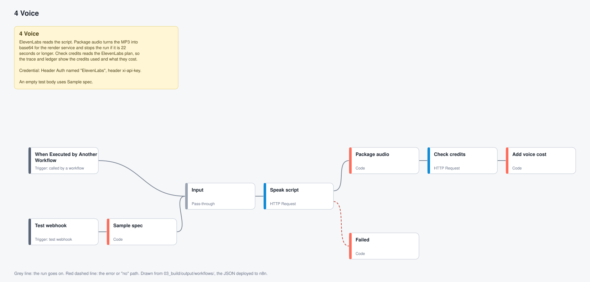
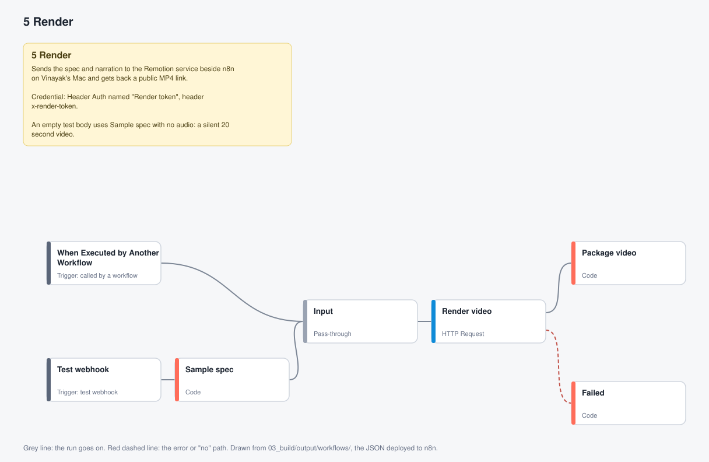
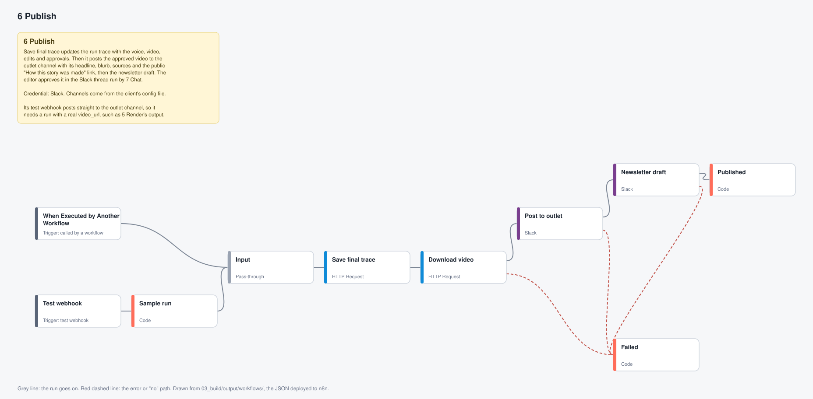

# Newsroom pipeline

The source for all seven workflows. Written 2026-11-14 by Arman with Claude Code; deployed and running end to end since that evening. Each step works for any City of Vancouver open data dataset with a date, a category and a neighbourhood field. The datasets are listed in one place, the "Vancouver sources" node in the orchestrator ([code/sources.js](code/sources.js)).

- `code/`: every Code node, the Write prompt and the source list
- [build.mjs](build.mjs): writes the workflow JSON into [../workflows/](../workflows/) (`npm run pipeline`)
- [test.mjs](test.mjs): runs the workflows' own Code nodes against live city data (`npm run test:pipeline`)

| Workflow | Does |
| --- | --- |
| 0 Orchestrator | Lists the sources, runs Collect, Score and Write, hands the draft to 7 Chat, and sends "No story today" to Slack when a step stops |
| 1 Collect | 9 weeks of one dataset, grouped by category, day and neighbourhood |
| 2 Score | Picks the week's strongest change across all sources |
| 3 Write | Claude writes the headline, script, chart title and blurb; the guard checks every number |
| 4 Voice | ElevenLabs reads the script; stops if it runs 22 seconds or longer |
| 5 Render | The Remotion service beside n8n makes the 9:16 video |
| 6 Publish | Posts an approved video to the outlet channel with the newsletter blurb |
| 7 Chat | The editor's review in one Slack thread per story: script and data first, then the video. Replies change either one; Claude revises and the guard checks every number (D14) |

## See the workflows

On our self-hosted n8n, a member account sees only the workflows it made (sharing is a paid n8n feature), so `npm run pipeline` draws each canvas from the same JSON it deploys. These pictures are always current. Vinayak, as owner, can also show the live editor on the host laptop.

## Getting it into n8n

1. Change code in `code/` or `build.mjs`, never the JSON in `workflows/`. Then `npm run pipeline` and `npm run test:pipeline`.
2. `npm run deploy` pushes all eight, the orchestrator last, and creates the data table `editor_threads` that 7 Chat keeps its threads in. Deploy points every Execute Workflow node at its workflow by name.
3. These credentials must exist in n8n with exactly these names, so the nodes find them. Fill in their values in the git-ignored `.env` (`ANTHROPIC_API_KEY`, `ELEVENLABS_API_KEY`, `RENDER_TOKEN`, `SLACK_BOT_TOKEN`) and run `npm run credentials`, which creates or updates each one and skips blanks. Then deploy again:

| Name | Type | Used by |
| --- | --- | --- |
| Anthropic | Anthropic | Write script (3 Write), Revise with Claude (7 Chat) |
| ElevenLabs | Header Auth, header `xi-api-key` | Speak script (4 Voice) |
| Render token | Header Auth, header `x-render-token` | Render video (5 Render) |
| Slack | Slack API, bot token | 6 Publish, 7 Chat, and "No story today" |

4. **Slack on the host laptop, for 7 Chat.** Slack sends thread replies and button taps to the tunnel, and the router checks each one's signature before passing it to n8n. Once, in this order:
   1. Pull, then put the Signing Secret from the Slack app's Basic Information page in the host laptop's `.env` as `SLACK_SIGNING_SECRET`.
   2. Restart the router: `npm run host -- stop`, then `npm run host`.
   3. In the Slack app's App Manifest page, paste [slack-app-manifest.yml](../host/slack-app-manifest.yml) and save. Slack checks the events address against the running router. Then reinstall the app to the workspace, since it asks for two new scopes to read thread replies.
5. Slack channels are set in `SLACK_CHANNELS` at the top of [build.mjs](build.mjs): `editor` for review, approval and "No story today" notes, `outlet` for approved videos and newsletter drafts. Put the channel IDs there, then `npm run pipeline` and `npm run deploy`. The bot must be invited to both channels. While an ID is empty, the build warns and those nodes deploy with no channel.

## Testing, one step at a time

Each step has a test webhook at `step-<step>`. An empty body runs it on a built-in sample.

| Command | Good result |
| --- | --- |
| `npm run invoke -- collect` | `ok: true`, 9 `weeks`, about 220 `types` (3-1-1) |
| `npm run invoke -- write` | `ok: true` and a `spec`. If `ok: false`, the reason names the number that was not in the story |
| `npm run invoke -- voice` | `ok: true` and `audio_seconds` under 22 |
| `npm run invoke -- render` | `ok: true` and a `video_url` that plays (silent, since the sample has no audio) |
| `npm run invoke -- publish run.json` | The video and blurb in the outlet channel. `run.json` is a saved 5 Render result. This posts straight to the outlet |
| `npm run invoke -- chat run.json` | A review message in the editor channel with the script, the data and Approve script. `run.json` is a saved 3 Write result; an empty body uses the sample |
| `npm run invoke -- orchestrator` | The whole run, ending with the review message in the editor channel |

Then in the review thread: reply with a change ("make the headline calmer", "use the weekly chart") and the bot posts a revised draft; tap Approve script and the video comes in the thread; reply again to change the video; tap Approve and publish and it is in the outlet channel.

Then the two failure tests from must-work:

- **Guard (row 9):** set `test_tamper` to `true` in [code/run-options.js](code/run-options.js), rebuild, deploy and run the orchestrator. The editor should get "No story today. Blocked: 219 in script is not in the story." Set it back.
- **Quiet (row 10):** `npm run invoke -- collect` with a body whose `dataset` is `no-such-dataset` ends at Failed with a reason. The test script checks the whole quiet path against live data.

## First full runs

The first full runs, on the evening of 2026-11-14, turned up four problems, each fixed and logged in [memory/failures.md](../../../memory/failures.md): Write's token budget, a credential deployed before it existed, narration over 22 seconds, and Publish not running when started in the background. Approve and Reject both work from Slack, and an approved video shows in the outlet channel with its headline, blurb and newsletter draft.

## How a run is passed along

Each step returns the run so far plus its own part, with `ok` saying whether to go on. The shapes are in [contracts.md](../../../_config/contracts.md).

## Checked against live data, 2026-11-14

`npm run test:pipeline` passed:

- Collect works for all three sources: 3-1-1 (222 categories), building permits (4) and business licences (70). In each, the neighbourhood counts add up to the week's count.
- Score picks 3-1-1 street flooding: 218 this week against an average of 29.3, 7.4 times. Runners-up: short-term rental concerns down to 7 from 36.8, fireworks 43 against 10.5.
- The guard passes a script with only story numbers and blocks one with a changed number. A reply that is not JSON stops the run.
- A dead dataset and a quiet week both end in the "No story today" note.

## Adding a Vancouver dataset

Add an object to [code/sources.js](code/sources.js): the dataset ID from its portal address, its date, category and neighbourhood fields, a unit such as "permits", and `date_only: true` if its date field has no time. Nothing else changes.
