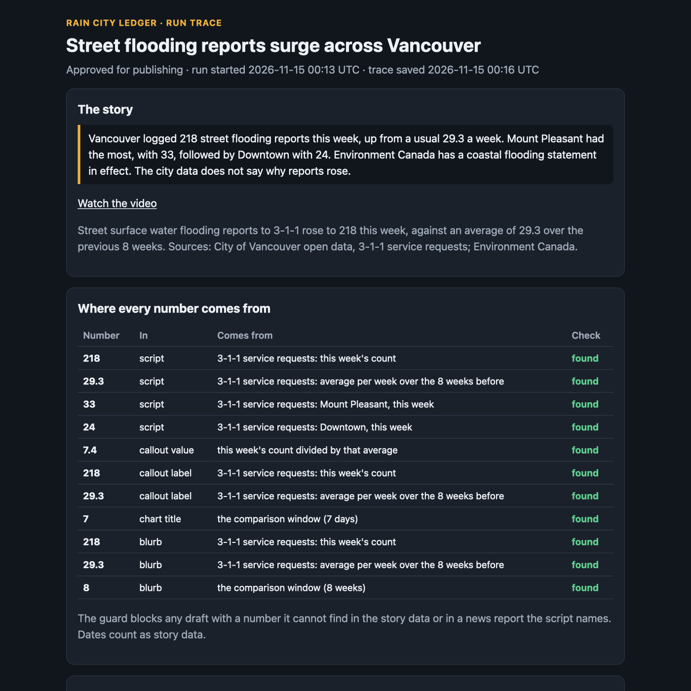
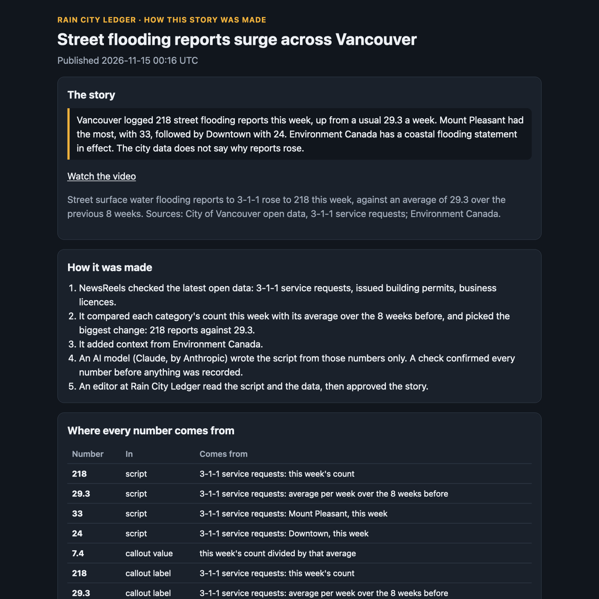
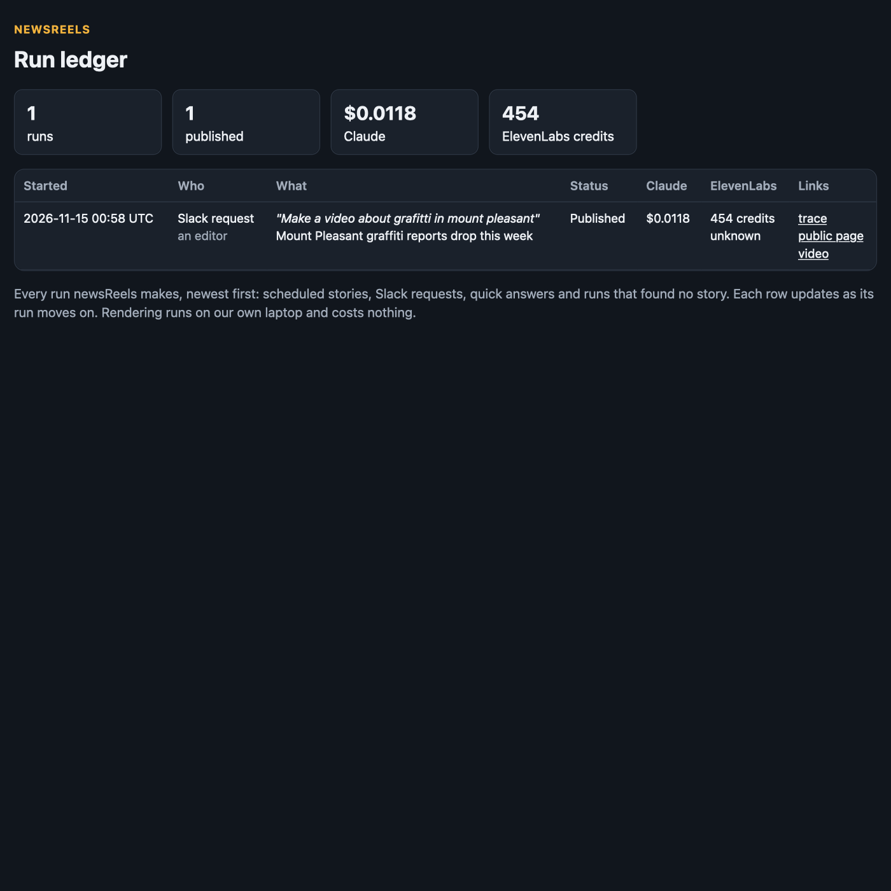

# Samples

Screenshots of real pages from 14 November 2026, with Slack user IDs replaced by "an editor". The live pages are served from the host laptop, so they are not reachable after the event.

- [Run trace](run-trace.png), for the editor: the street flooding story, 218 reports against a usual 29.3, with the Environment Canada flooding statement as context. The full trace goes on to the ranking, the news offered, what Claude was asked and answered, the edits, approvals and cost.
- [Request trace](request-trace.png): "Make a video about graffiti in mount pleasant", asked in Slack and matched to all six graffiti categories in Mount Pleasant.
- [How this story was made](how-this-story-was-made.png): the public page linked from each published post.
- [Run ledger](run-ledger.png): one row per run, with who asked, the status and the cost.
- [Chart types](chart-types.png): the same story as a line, a pie with Mount Pleasant in red, and bars, as an editor can ask for from the thread. [thumbnail.png](thumbnail.png) is its 3:2 crop for Devpost.
- [n8n orchestrator](n8n-orchestrator.png): the orchestrator's canvas, drawn from its workflow JSON.

